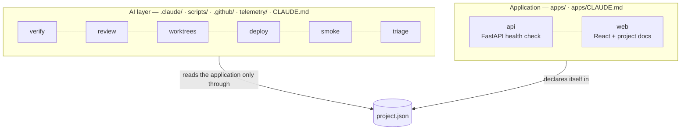
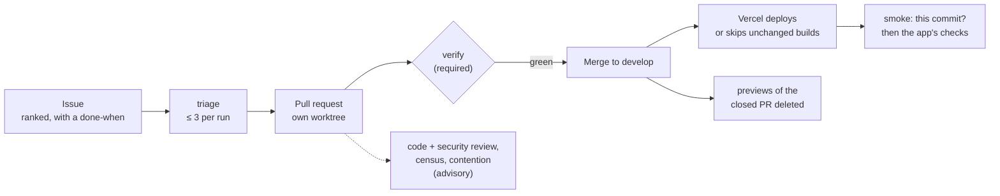

# boris

A practice ground for running software work with AI agents, climbing the steps
in [`docs/adoption.md`](docs/adoption.md), a rendering of *Steps of AI
Adoption* (Boris Cherny, Jul 2026). The thing being built is the loop that
builds software — not any particular application it happens to be running
against.

## Two layers



**The AI layer** is the machinery that works on the application:

- the contract (`npm run verify`) and a stop hook that blocks an agent from
  ending its turn while `verify` is red, giving up after three attempts;
- automatic code and security review on every pull request;
- per-agent worktrees with their own ports;
- build skipping, deployment, post-merge smoke and preview cleanup on Vercel;
- `triage` and the `work-backlog`/`drive-pr` skills, which pick issues and
  drive them to merge within declared limits.

**The application**, under `apps/`, is currently two deployable placeholders —
a health-check API and a web shell serving this repository's own
documentation — kept live so the Vercel projects and smoke checks keep
passing while a real workload is chosen. The AI layer learns about it only
from [`project.json`](project.json); swapping in a real application means
changing `apps/` and that one file, nothing else in the AI layer.

## Quick start

Needs Node 22, [uv](https://docs.astral.sh/uv/) and Python 3.12.

```bash
npm run bootstrap     # npm ci, uv sync per Python app, Playwright, the LSP servers
npm run verify        # the whole contract: the AI layer's tests, then every app's checks
npm run dev           # the web app on http://localhost:5173
```

The API locally, with its developer consoles on:

```bash
cd apps/api && API_ENVIRONMENT=development uv run uvicorn api.main:app --reload
```

Changing a dependency needs npm 11 for the lock step (`npx npm@11 install`);
[`CLAUDE.md`](CLAUDE.md) says why.

## How a change travels



1. **An issue** says what is wrong and what "done" looks like, with a rank
   label (`critical`, `high` or `medium`). Work for a person is labelled
   `human` and `do not automate`.
2. **Triage** (`node scripts/triage.mjs`) picks what an agent may take on:
   it skips issues a person owns, issues already in flight, and issues with
   open dependencies, and takes at most three per run.
3. **A pull request** from its own worktree. `verify` is the only required
   check. The code review, security review, test census and cross-PR
   conflict check comment on it but don't block it.
4. **Merge deploys.** Both Vercel projects build from `develop`, unless
   nothing a project reads changed, in which case the build is skipped.
5. **Smoke** checks each deployed app is serving this commit (or an
   equivalent skipped build), then runs that app's own checks.
6. **Preview cleanup:** closing the pull request deletes its preview
   deployments.

## Swapping the application

1. Replace what is under `apps/`, including `apps/CLAUDE.md`, each app's
   `vercel.json` and `smoke.sh`, and the app skills in `apps/.claude/skills/`.
2. Rewrite [`project.json`](project.json). Each app declares:

   | Field | Meaning |
   | --- | --- |
   | `path`, `toolchain` | Where it lives; `python` or `node`. |
   | `verify` | Its checks, run from its directory by `npm run verify`. |
   | `reads`, `ignores` | What its build reads, so unchanged builds are skipped. |
   | `vercelProject`, `url`, `commitEndpoint` | For a deployed app: where it answers, and the endpoint reporting the commit it was built from. |
   | `smoke` | Its post-deploy checks, a script inside the app. |

3. **Rewrite [`docs/data-governance.md`](docs/data-governance.md)** before
   deploying anything real. Its verdict applies to the current placeholder
   apps, which serve no data at all, and any real application voids it.
   [`docs/extraction.md`](docs/extraction.md) lists what else is a conclusion
   rather than a reusable part.

## Documentation

| Where | What |
| --- | --- |
| [`CLAUDE.md`](CLAUDE.md) | The AI layer's rules, which every agent session loads. |
| [`apps/CLAUDE.md`](apps/CLAUDE.md) | The application's rules, layout and deployments. |
| [`docs/sops.md`](docs/sops.md) | How agent work is run, including every loop's declared limit. |
| [`docs/data-governance.md`](docs/data-governance.md) | What is exposed, why, and what would change that. |
| [`docs/extraction.md`](docs/extraction.md) | What is reusable elsewhere, and the separation proof. |
| [`docs/adoption.md`](docs/adoption.md) | The adoption ladder being climbed. |

The docs are also published at `/docs/` on the web deployment, and the API
serves its own manual at its root.

## Repository secrets

| Secret | Used by |
| --- | --- |
| `CLAUDE_CODE_OAUTH_TOKEN` | The code and security reviews, and `@claude` in issues and PRs. |
| `VERCEL_TOKEN` | Preview cleanup. Team-scoped; expires 2027-09-23. |
| `TELEGRAM_BOT_TOKEN`, `TELEGRAM_CHAT_ID` | Merge notifications. |
| `GRAFANA_CLOUD_OTLP_ENDPOINT`, `GRAFANA_CLOUD_OTLP_AUTH` | Telemetry from the Claude CI jobs ([`telemetry/`](telemetry/README.md)). |

Deploys don't use a token: they run through Vercel's Git integration.
