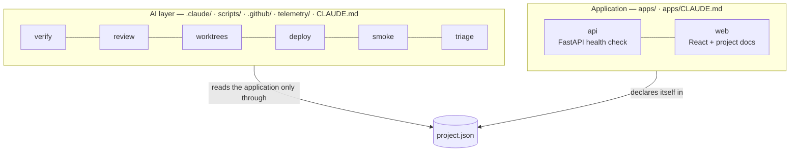
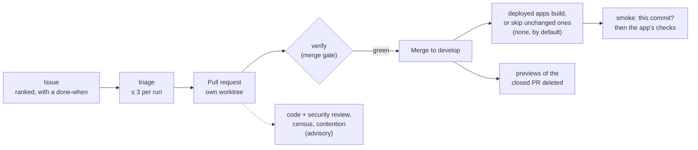

# boris

A practice ground for running software work with AI agents, climbing the steps
in [`docs/adoption.md`](docs/adoption.md), a rendering of *Steps of AI
Adoption* (Boris Cherny, Jul 2026). The thing being built is the loop that
builds software — not any particular application it happens to be running
against.

## Start a new project from this base

Two commands get a new project from an empty folder to picking its first
issue. Steps marked **[you]** need a person: an agent may not handle
credentials, money, or a dashboard behind a login.

**Before you start:** Node 22, [uv](https://docs.astral.sh/uv/) and Python 3.12
(only for a product with a Python app), `gh` logged in as the owner
(`gh api user --jq .login`), SSH access to GitHub (`ssh -T git@github.com`
greets you by name: `create` pushes over SSH), and a Claude subscription to
pay for CI reviews. Don't create the GitHub repository first: `create` makes
it. An empty one is accepted, but one with any branch is refused.

1. **Create the project.** From a clone of this repository, choose its parts.
   `node scripts/assemble.mjs --list` shows what [`catalogue.json`](catalogue.json)
   offers: starters (an app and what it needs) and deploy providers.

   ```bash
   gh repo clone stevemarvell/boris
   npm run bootstrap
   node scripts/setup.mjs create --name <project> --owner <github-owner> \
     [--starter python-fastapi] [--starter <another>] [--deploy vercel] [--dir <path>] [--public]
   ```

   Use `node scripts/setup.mjs`, not `npm run setup --`: on Windows, npm's
   PowerShell shim drops the `--`, npm takes `--name`, `--owner` and the rest as
   its own config and strips them, and the script sees only the bare values.
   `node` bypasses npm and works in every shell.

   Give `--starter` once for each app. With none, `create` builds an
   **engine-only** product: the engine and the generated files, a
   `project.json` with `"apps": {}`, no `apps/` directory and no `workspaces` in
   its root `package.json`, so its `verify` is the AI layer's own checks, and
   `verify:apps` says it has no app to run. Nothing in it installs Python or a
   browser, and its `dependabot.yml` has no `uv` entry. Use it for a product
   that is not a web or API app. An unknown starter or provider stops `create`
   before anything is created, naming what the catalogue offers; so does an
   `--owner` that is not a GitHub name, a `--dir` that is not empty, and a
   checkout of this base with
   uncommitted changes to tracked files. `create`
   does the following:
   - builds the project into `--dir` (default `../<project>`) from the engine,
     the chosen starters and a `project.json` of their apps, by running
     `scripts/assemble.mjs`, with no history from this base;
   - records the base commit it was built from as `engine.commit` in
     `project.json`;
   - locks a project without a `package-lock.json` (one with only Python
     starters, or none) with `npx npm@11 install`, so its CI can run `npm ci`;
   - runs `verify`, and stops there, with nothing created on GitHub, if it fails;
   - makes one commit, with this base as a fetch-only remote, so you can pull
     updates and measure how far behind you are but never push to it;
   - creates the GitHub repository (private unless `--public`), stopping if it
     already has content, and pushes;
   - finishes by running `check` inside the new repository.

   If a step after `verify` fails (creating the repository, the push), the
   GitHub repository may exist but be empty: a rerun accepts an empty one, but
   `--dir` must be removed first.

   `--deploy` deploys nothing: a Vercel project is yours to create. It checks
   the provider exists and prints the `npm run deploy:add -- <provider> --app
   <app>` command for each app, to run in the new repository (for an
   engine-only product it says there is nothing to deploy yet).

   **Adding a starter later.** An engine-only product that now needs an app
   runs, inside itself and from a clean tree:

   ```bash
   node scripts/setup.mjs add --starter node-react --starter python-fastapi
   ```

   `add` fetches this base at the product's `engine.commit` through the
   fetch-only remote `create` set up, copies each starter's files, adds its
   entry to `project.json` and regenerates `package.json`, `dependabot.yml`,
   `README.md` and `CLAUDE.md`: the same tree `create` would have made with
   those starters. It refuses a dirty tree, an app path that already exists and
   an unknown starter, before it writes anything. A generated file the product
   has rewritten since is left as it is and named, for you to edit by hand.
   Whenever `package.json` changed, `add` also runs `npx npm@11 install`, which
   needs the network and writes `package-lock.json` (a lockfile the product
   already has is updated, not replaced; one a starter brings is used as it is,
   with no install). It then prints the next steps: `npm run bootstrap` and
   `npm run verify`.

   Until #290 is fixed: once Dependabot has bumped the root `package.json`,
   `add` keeps it rather than regenerating it. Add the starter's
   `workspaces` entry and workspace scripts by hand, then align the
   starter's eslint and vitest pins with the root's (`tooling.test.ts`
   fails until they match), then run `npx npm@11 install`.

2. **[you] Add `CLAUDE_CODE_OAUTH_TOKEN` before the first pull request.**
   Run `claude setup-token`, then set it on the new repository by name:
   the project has two remotes (`origin` and the fetch-only base), so `gh`
   asks which one to use unless told (#284).

   ```bash
   gh secret set CLAUDE_CODE_OAUTH_TOKEN -R <owner>/<project>
   ```

   In Git Bash on Windows, `gh` can't show its hidden prompt ("running in
   MinTTY without pseudo terminal support"). Pipe the token in instead:

   ```bash
   read -rs TOKEN    # paste, press Enter; nothing shows
   printf %s "$TOKEN" | gh secret set CLAUDE_CODE_OAUTH_TOKEN -R <owner>/<project>
   unset TOKEN
   ```

   It is an OAuth token, not an API key. Without it, every pull request's
   code and security review posts "Claude encountered an error".

3. **Run `check` until nothing is left for you.** From the new repository:

   ```bash
   GH_REPO=<owner>/<project> node scripts/setup.mjs check   # --dry-run to change nothing, --skip-verify to skip the tests
   ```

   `GH_REPO` is needed until #284 is fixed: with two remotes, `gh secret
   list` fails with "multiple remotes detected", even after
   `gh repo set-default`. `check` also files "Add CLAUDE_CODE_OAUTH_TOKEN"
   when the secret is already set (#285); close that issue by hand.

   Every line is ✔ (already done), ✚ (fixed just now) or ✋ (yours, with the
   exact command or click-path). It exits 0 only when no ✋ remains. It can be
   re-run as often as you like and never duplicates anything. It:
   - creates the labels from [`labels.json`](labels.json);
   - turns on delete-branch-on-merge;
   - protects `develop` if the repository is public. A private repository on
     GitHub's free plan can't protect a branch, so "PRs only" is a rule
     people follow there;
   - files your own work as issues labelled `human` + `do not automate`:
     the token above, Dependabot's first PR, rewriting the README and
     `CLAUDE.md` around the product, and Telegram and Grafana, each optional
     and in its own issue;
   - adds the story template issue, filed from `.github/ISSUE_TEMPLATE/story.md`,
     the same file GitHub's "New issue" button offers;
   - runs the name check, which fails if this base's name is left anywhere it
     should not be;
   - reports how far behind this base the project is, in commits, from the
     recorded `engine.commit`. That is information (ℹ), never a ✋, and it
     does not change the exit code;
   - runs `verify`.

4. **File the backlog.** Give every issue a rank label
   (`critical`/`high`/`medium`), a `Depends on #<n>` line where it has one,
   and acceptance criteria. Triage is only as good as that data.

5. **Ship one small PR end to end** before trusting the loop. Check that both
   reviews post real verdicts rather than errors.

6. **Start the work:** `node scripts/triage.mjs`, or the `work-backlog`
   skill.

### Adding deployment (optional)

Nothing is deployed by default, and every check passes without it. When an
app should go live on Vercel:

```bash
npm run deploy:add -- vercel --app <app> [--team T --project P --url U --commit-endpoint /health]
```

This writes the app's `deploy` block into `project.json`, adds its
`vercel.json` and `deployment` skill, and prints the steps that are yours:

1. **[you]** Create the Vercel project with Root Directory `apps/<app>`.
2. **[you]** Turn off Vercel Authentication under Deployment Protection, or
   smoke checks and agents get a login page instead of the app.
3. **[you]** Copy the production URL from the project's domain list. Don't
   guess it: the short alias isn't guaranteed.
4. **[you]** Add a team-scoped `VERCEL_TOKEN` secret before the first PR
   closes, or preview cleanup fails on every closed PR. Record its expiry
   under *Repository secrets* below.

Re-run `check` afterwards. It then also checks that each deployed app
answers, that the token is present, and that its expiry is recorded.

### Things to know

- **Agents write the code.** The session you talk to triages, briefs,
  reviews and merges green pull requests without asking (`CLAUDE.md`).
- **Check each change on its deployed preview**, not just in CI. Green CI
  has missed real bugs that the preview showed.
- **Data an app reads must sit inside its Vercel Root Directory**, or it
  never reaches the deployment.
- **Force-push is denied.** Bring a branch up to date by merging `develop`
  into it, not by rebasing.
- **Parallel pull requests often edit the same files.** Resolve those
  conflicts by keeping both sides, and choose by hand which issues can run
  side by side.
- **Pull later improvements from this base** with the `sync-ai-layer` skill.

## The parts a product is made of

A product is assembled from three kinds of part. They are declared where they
already live, in [`catalogue.json`](catalogue.json), not moved into folders.

| Part | Where it lives | In a product |
| --- | --- | --- |
| **Engine** | `.claude/`, `scripts/`, `.github/`, `telemetry/`, `docs/sops.md`, `labels.json` and a few root files, as an explicit allowlist in the catalogue. | Synced from this base for good (`sync-ai-layer`). |
| **Starters** | Each app directory under `apps/`: `apps/api` is `python-fastapi`, `apps/web` is `node-react`. Each carries its own `CLAUDE.md` and skills, and the catalogue lists the few files it needs outside its directory. | Copied once, then the product's own. |
| **Providers** | `scripts/deploy/<name>/`, starting with `vercel`. | The code ships with the engine; `npm run deploy:add` copies the template files once. |

The catalogue also lists what is written fresh for each product (its own
`CLAUDE.md`, `README.md`, `project.json`, `package.json` and
`docs/data-governance.md`), what is copied once (`.claude/settings.json`), and
what never leaves this base (`docs/adoption.md`, the step-0 `index.html`,
`.claude/trials/`, and the catalogue and its tests). It is plain data: a
planner reads it without running anything here.

`scripts/assemble.mjs` builds a product tree from it, into an empty directory:

```bash
node scripts/assemble.mjs --list
node scripts/assemble.mjs --target ../my-product --name my-product --starter python-fastapi --starter node-react
```

It runs no git, no network and no install, and refuses a target that already
has anything in it. `npm run verify` assembles each starter into a temporary
directory and checks the result: `project.json` validates, every engine file
is present, the starter's files are present, and nothing else is.

## Two layers



**The AI layer** is the machinery that works on the application:

- the contract (`npm run verify`) and a stop hook that blocks an agent from
  ending its turn while `verify` is red, giving up after three attempts;
- automatic code and security review on every pull request;
- per-agent worktrees with their own ports;
- an optional per-app `deploy` block, build skipping, post-merge smoke and
  preview cleanup for whichever apps actually have one;
- `triage` and the `work-backlog`/`drive-pr` skills, which pick issues and
  drive them to merge within declared limits.

**The application**, under `apps/`, is currently two placeholders — a
health-check API and a web shell serving this repository's own
documentation — while a real workload is chosen. Neither is deployed: this
repository's own default is nothing deployed anywhere, so `npm run verify` is
what keeps them green, not a live Vercel project. The AI layer learns about
the application only from [`project.json`](project.json); swapping in a real
application means changing `apps/` and that one file, nothing else in the AI
layer. `npm run deploy:add` is what a repository built from this one uses to
put an app on Vercel.

## Quick start

Needs Node 22, [uv](https://docs.astral.sh/uv/) and Python 3.12.

```bash
npm run bootstrap     # npm ci, uv sync per Python app, Playwright, the LSP servers
npm run verify        # the whole contract: the AI layer's tests, then every app's checks
npm run dev           # the web app on http://localhost:5173
```

The API locally, with its developer consoles on:

```bash
cd apps/api && API_ENVIRONMENT=development uv run uvicorn api.main:app --reload
```

Changing a dependency needs npm 11 for the lock step (`npx npm@11 install`);
[`CLAUDE.md`](CLAUDE.md) says why.

## How a change travels



1. **An issue** says what is wrong and what "done" looks like, with a rank
   label (`critical`, `high` or `medium`). Work for a person is labelled
   `human` and `do not automate`.
2. **Triage** (`node scripts/triage.mjs`) picks what an agent may take on:
   it skips issues a person owns, issues already in flight, and issues with
   open dependencies, and takes at most three per run.
3. **A pull request**, written by an `implementer` agent in its own worktree.
   `verify` is the one check the coordinator waits for before merging;
   nothing mechanical requires it on a free-plan private repository. The code review, security review, test census and cross-PR
   conflict check comment on it but don't block it.
4. **Merge deploys whatever has a `deploy` block.** By default nothing does
   — `npm run deploy:add` is what adds one — but a deployed app builds from
   `develop`, unless nothing it reads changed, in which case the build is
   skipped.
5. **Smoke** checks each deployed app is serving this commit (or an
   equivalent skipped build), then runs that app's own checks. With nothing
   deployed, it finishes green with a notice instead.
6. **Preview cleanup:** closing the pull request deletes any deployed app's
   preview deployments.

## Swapping the application

1. Replace what is under `apps/`, including each app's own `CLAUDE.md`,
   `smoke.sh` and skills (the web starter's `docs-site` skill is in
   `apps/web/.claude/skills/`), and the matching starter in
   [`catalogue.json`](catalogue.json).
2. Rewrite [`project.json`](project.json). Each app declares:

   | Field | Meaning |
   | --- | --- |
   | `path`, `toolchain` | Where it lives; `python` or `node`. |
   | `verify` | Its checks, run from its directory by `npm run verify`. |
   | `reads`, `ignores` | What its build reads, so unchanged builds are skipped. |
   | `deploy` | Optional. `{ provider, team, project, url, commitEndpoint }` — where it answers and the endpoint reporting the commit it was built from. `npm run deploy:add` writes this for you. |
   | `smoke` | Its post-deploy checks, a script inside the app, run when `deploy` is set. |

3. **To actually deploy an app**, run `npm run deploy:add -- vercel --app
   <app> ...` (`scripts/deploy/add.mjs`). It writes the `deploy` block, drops
   in that provider's `vercel.json` and `deployment` skill
   (`scripts/deploy/vercel/template/`), and prints the steps that are yours:
   creating the real Vercel project, turning off Deployment Protection's
   Vercel Authentication, copying the real production URL, and adding
   `VERCEL_TOKEN`.
4. **Rewrite [`docs/data-governance.md`](docs/data-governance.md)** before
   deploying anything real. Its verdict applies while nothing is deployed,
   and any real deployment voids it.

## Documentation

| Where | What |
| --- | --- |
| [`CLAUDE.md`](CLAUDE.md) | The AI layer's rules, which every agent session loads. |
| [`apps/CLAUDE.md`](apps/CLAUDE.md) | The application's layout and deployments; each starter's own rules are in its `CLAUDE.md`. |
| [`catalogue.json`](catalogue.json) | The engine, starters and providers a product is assembled from. |
| [`docs/sops.md`](docs/sops.md) | How agent work is run, including every loop's declared limit. |
| [`docs/data-governance.md`](docs/data-governance.md) | What is exposed, why, and what would change that. |
| [`docs/adoption.md`](docs/adoption.md) | The adoption ladder being climbed. |

Nothing is deployed by default, so none of this is published anywhere today.
`npm run deploy:add` is what would make the web app's `/docs/` and the API's
own manual reachable, once there is a deployment for them to live on.

## Repository secrets

A clone carries none of these. The owner adds each one with
`gh secret set <name>`; an agent never handles them. `node scripts/setup.mjs check`
reports which are missing by name only.

| Secret | Used by | Add it |
| --- | --- | --- |
| `CLAUDE_CODE_OAUTH_TOKEN` | The code and security reviews, and `@claude` in issues and PRs. | **Before the first pull request.** `claude setup-token`. |
| `VERCEL_TOKEN` | Preview cleanup for apps that `npm run deploy:add` put on Vercel. | **Before the first pull request closes** after a Vercel project exists. Team-scoped, with an expiry recorded here. Not needed while nothing is deployed. |
| `TELEGRAM_BOT_TOKEN`, `TELEGRAM_CHAT_ID` | Merge notifications. | Optional, whenever wanted. |
| `GRAFANA_CLOUD_OTLP_ENDPOINT`, `GRAFANA_CLOUD_OTLP_AUTH` | Telemetry from the Claude CI jobs ([`telemetry/`](telemetry/README.md)). | Optional, whenever wanted. |

Deploys don't use a token: they run through Vercel's Git integration.
